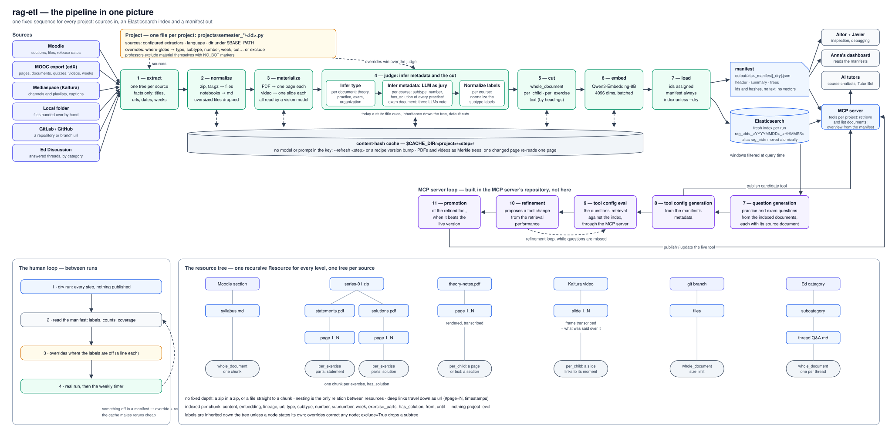

# rag-etl

The RAG pipeline of CEDE (EPFL). It gathers a project's material (a course on
Moodle, a MOOC export, lecture videos, a folder, a git repository, Ed
Discussion threads), turns it into text, labels it, cuts it into chunks,
embeds them and publishes them to Elasticsearch, where the course chatbots,
the forum bots and the MCP server retrieve from them.

Everything runs in-house: models on RCP, files on disk, one Elasticsearch
index per project.



## Install

Python 3.12 or later.

```bash
python -m venv venv
venv/bin/pip install -e ".[dev]"
cp .example.env .env    # then fill it in
```

The settings come from the environment; a `.env` found from the working
directory upwards fills in what the environment lacks. The main ones:

| Variable | What for |
|---|---|
| `BASE_PATH` | where the project folders live |
| `CACHE_DIR` | the disk cache (must exist) |
| `RCP_BASE_URL`, `RCP_API_KEY` | the models (OCR, labelling, exercise splitting, embeddings) |
| `MOODLE_URL`, `MOODLE_TOKEN` | Moodle sources |
| `KALTURA_*`, `SWITCH_API_URL`, `DEFAULT_MEDIASPACE_BASE_URL` | videos |
| `GRAPH_AI_*` | slide-change detection in videos |
| `ES_HOST`, `ES_PORT`, `ES_USERNAME`, `ES_PASSWORD`, `ES_CAFILE` | publishing |
| `LANGFUSE_*` | tracing of the model calls |

A variable is only required by the step that uses it: a run that never
touches Moodle needs no Moodle token.

## Run

```bash
rag-etl run --project micro303 --dry          # everything but publishing
rag-etl run --project micro303                # publish to rag_micro303
rag-etl run --project micro303 --refresh materialize   # redo one step, ignoring its cache
```

`--refresh` accepts `normalize`, `materialize`, `cut` and `embed`. Use it
after changing a prompt or a model: the cache is keyed by content only and
would otherwise serve the old results.

What a run leaves behind:

```
$BASE_PATH/<project>/
├── moodle/, mooc/, …     what each source downloaded or holds
├── work/                 scratch, wiped at the start of every run
└── output/               one manifest per run: <timestamp>_manifest[_dry].json
$CACHE_DIR/<project>/<step>/…   everything a model produced, reused across runs
```

A real run publishes into a fresh index `rag_<project>_<YYYYMMDD>_<HHMMSS>`
and then moves the alias `rag_<project>` to it in one step. A failed run
leaves the alias where it was; older indices stay for rollback.

## How it works

One fixed sequence, the same for every project:

1. **extract** — each source becomes a tree of resources (folders, files, threads), with the facts the source states: titles, urls, release dates, weeks.
2. **normalize** — archives are unpacked, notebooks become markdown, oversized files are dropped.
3. **materialize** — every PDF page and image is read by a vision model; videos become one slide per slide change, with what was said over it.
4. **judge** — every resource gets a type, a subtype and a cut. Today a stub reads cues from the titles; the project's overrides correct it.
5. **cut** — resources become chunks: the whole document, one per child (page, slide), one per exercise, or one per heading section.
6. **embed** — every chunk gets its vector (Qwen3-Embedding-8B).
7. **load** — the manifest is written, and unless dry the index is published.

The manifest is for people: it summarizes what the run produced (counts per
source, type, subtype, number…) and mirrors the trees without their text.
Read it after a dry run to check the labels.

## Adding a project

One file per project, in the current semester folder, named after the
project, defining it under its id in capitals:

```python
# src/rag_etl/projects/semester_2627_autumn/micro303.py
from pathlib import Path

from rag_etl.core import Override
from rag_etl.extractors import LocalFolderExtractor, MOOCExtractor, MoodleExtractor
from rag_etl.projects import Project

MICRO303 = Project(
    id="micro303",
    language="en",
    dir=Path("MICRO303"),   # under $BASE_PATH; the id when left out
    overrides=(
        Override('path="*/mooc/*" AND filename="*.quiz*.md"', type="practice", subtype="mooc_quiz", cut="whole_document"),
        Override('title="*Raw HTML"', exclude=True),
    ),
    sources=(
        MoodleExtractor(dir=Path("moodle"), course_id=19283),
        MOOCExtractor(dir=Path("mooc"), first_week_chapter=2, week_count=7, language="en",
                      course_url="https://courseware.epfl.ch/learning/course/course-v1:EPFL+mems+2023/home"),
        LocalFolderExtractor(dir=Path("local")),
    ),
)
```

Sources available: `MoodleExtractor`, `MOOCExtractor`, `MediaspaceExtractor`
(a Mediaspace channel or playlist), `LocalFolderExtractor`, `GitExtractor` and
`EdDiscussionExtractor`.

**Overrides** fix what the judge gets wrong. The `where` is a list of globs
joined by `AND` over a resource's attributes (`title`, `path`, `filename`,
`mime_type`, `type`, `subtype`, `number`, `week`, …); the rest sets any of
`cut`, `type`, `subtype`, `number`, `subnumber`, `week`, `exercise_parts`,
`has_solution`, `from_`, `until`, or `exclude=True` to leave the resources out.
A literal `[` is written `[[]`. When several overrides match, the one with
more predicates wins.

Professors exclude material themselves by marking it `NO_BOT` (in Moodle, in
a file or folder name, in a MOOC page).

**A new project's first runs**: dry run, read the manifest, add overrides
where the labels are off, dry run again, then a real run. After that the
project can join the weekly schedule; when a manifest shows something off,
add an override and rerun.

## Using `ragtools` on its own

`ragtools` is the file-preparation half of the repository and does not
depend on the pipeline, so it can be used directly:

```python
from ragtools.pdf import save_pdf_pages
from ragtools.images import transcribe_page
from ragtools.notebooks import convert_ipynb_to_md
from ragtools.documents import split_exercises

pages = save_pdf_pages("series-3.pdf", "pages/")        # one PNG per page
text = "\n\n".join(transcribe_page(page) for page in pages)   # read by the RCP vision model
exercises = split_exercises(text)                       # number, parts, text per exercise

convert_ipynb_to_md("tp2.ipynb", "tp2.md")
```

## Development

```bash
venv/bin/python -m pytest -q
venv/bin/ruff check src tests
```

Tests use synthetic fixtures and stubbed models: no network, no RCP. Read
[AGENTS.md](AGENTS.md) for the design and the conventions before changing
the code.

`legacy/` holds the code from before the rewrite, for reference only: it is
not packaged nor tested, and goes once the consumers have switched over.
